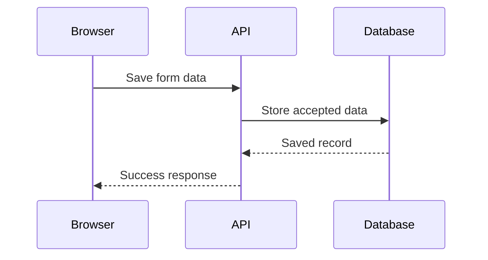

# Mental

Explain the system through its actors, boundaries, and communication.

## Output contract: diagram first

A completed mental explanation MUST include a diagram in the response itself.
Write one short sentence to orient the reader, then immediately include either:

- A fenced code block whose language tag is exactly `mermaid` (the default).
- An embedded, rendered D2 image, if rendering is available and D2 is requested.

Then explain the flow and its evolution in concise prose. Construct the diagram
before writing the longer explanation, so the visual cannot be dropped at the end.
This contract also applies to short answers and follow-up explanations that
continue an explicitly invoked mental-model discussion. A clarification question
alone does not need a diagram. If the user explicitly requests no diagram, follow
that request.

ASCII arrows, bullet lists, tables, ordinary code blocks, a link to a diagram,
a promise to draw one later, and unrendered D2 source do not satisfy this contract.
Do not ask whether the user wants a diagram. If no renderer is available, emit
Mermaid source anyway; do not replace it with text because the chat might not
render it. No diagram-generation tool is needed for a Mermaid code block.

Example of the required response shape (adapt the actors to the actual context):

~~~~markdown
The browser asks the API to save data; the API owns database access.

The form starts in the browser. Adding an API lets it save remotely; adding a
database lets the saved data outlive an individual request.
~~~~

## Explicit invocation

Use this skill only when the user explicitly requests it: `/mental`, `$mental`,
or a direct request to use the mental skill. A general request for an explanation
does not activate this skill. Treat this as an explanation request, not permission
to implement, install, publish, or change the system being explained.

Use the topic following the invocation, or infer it from the conversation. Ask
one focused question only if the topic cannot reasonably be inferred.

## Build the explanation

1. Ground the model in the conversation and available evidence. For an existing
   codebase, inspect only the entry points or configuration needed to establish
   the relevant relationships. Distinguish observed facts from assumptions. Do
   not invent services, successful deployments, or verified behavior.
2. Start with the smallest useful system: one script running locally, a browser
   showing a page, or a service responding to a request. Explain what already
   works before introducing infrastructure.
3. Progress toward the system under discussion. At each meaningful stage, explain
   the new need, the actor or connection added to satisfy it, and how an action
   now travels through the system. These are explanatory stages, not claims about
   historical chronology. If the user asks about actual project evolution, use
   the available history and identify gaps.
4. Choose actors by context: people, processes, services, storage, registries,
   queues, or external providers. Give each a concrete role. Group related actors
   by machine, process, or network boundary when location affects understanding.
5. Trace one concrete action through the actors in order, including the result
   returning to the caller. Label what crosses each boundary: source code,
   package archive, HTTP request, JSON response, event, or stored data. Separate
   setup and distribution from runtime communication when both matter.
6. Explain distinctions only where they resolve confusion. For example, a package
   name selects what to fetch, a command name selects what to run, and an argument
   becomes input to that command. For a browser/API example, distinguish code
   delivery from later API requests.

Prefer a short progression with connected prose over a glossary or a catalogue
of components. If the user wants only the current interaction, show that flow
without forcing a long evolution. Commands and snippets should anchor the model;
avoid flag inventories, implementation walkthroughs, and unrelated alternatives.
Retain details that change the model, such as a cache avoiding a download or an
asynchronous acknowledgement arriving before work finishes.

## Diagram accuracy

Every response produced with this skill must contain at least one Mermaid
diagram or a rendered D2 image. Default to a fenced `mermaid` block: it requires
no rendering tools and the source remains readable when rendering is unavailable.

- Use a flowchart for topology, boundaries, or stages; use a sequence diagram
  when request order, replies, or asynchronous messages are central.
- Use concrete actor names and directional arrows labeled with actions or data.
  Avoid unlabeled arrows and decorative boxes that explain nothing.
- Keep each diagram focused on the interaction being explained. Split different
  phases or crowded systems into small diagrams. In staged diagrams, mark which
  actors and connections are newly introduced.
- Keep labels simple and quote flowchart labels containing punctuation. Check
  node references, arrow direction, subgraphs, and fenced syntax before sending.
- A package registry distributes code; do not draw it as executing the user's
  CLI. A database stores data; do not draw it as initiating ordinary application
  requests unless that is an actual feature of the system.
- If the user prefers D2 and a renderer is available, render and inspect the
  result, then embed the image. D2 source alone does not satisfy the image
  requirement. If rendering is unavailable, use Mermaid and state the fallback
  briefly. Do not install a renderer just to explain the model.

Follow the diagram with a short walkthrough of the concrete action. End when the
model is clear; do not append implementation tasks or generic summaries.

## Before sending

Inspect the response itself: does it contain a fenced `mermaid` block or an
embedded rendered D2 image? If neither is present, the explanation is incomplete.
Add the diagram before sending. Check that its arrows match the prose and trace
at least one real interaction with concrete actors and labeled communication.

## Examples

Read [references/examples.md](references/examples.md) when examples would help
calibrate the explanation. It includes npm distribution, frontend/backend calls,
service-to-service calls, and asynchronous jobs. Adapt the approach to the actual
context rather than importing those actors into every explanation.
