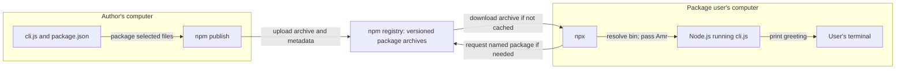
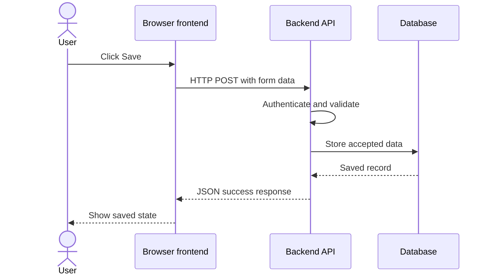
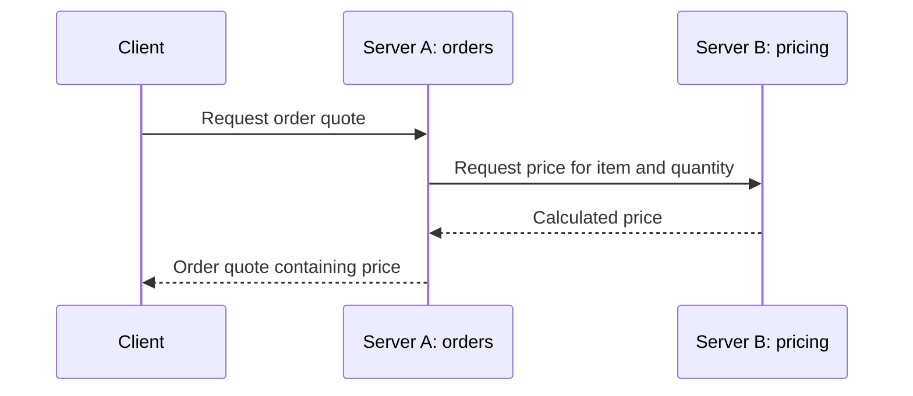
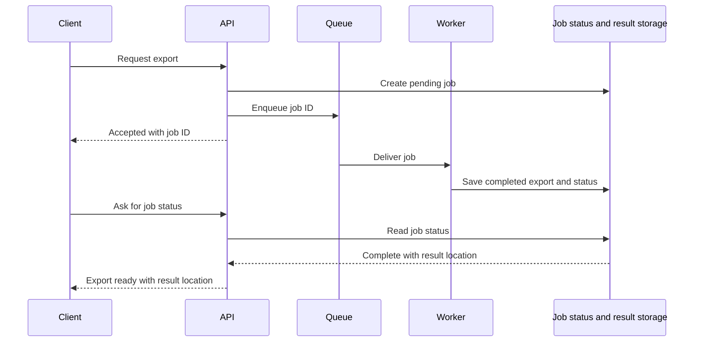

# Mental model examples

These are illustrative scenarios, not assertions about a user's deployment.
Choose the relevant example rather than reproducing all of them.

## npm: from a local script to distribution

Example request: `/mental take me from node cli.js to someone using my package`

Start with the author running `node cli.js Amr`: Node executes a file already on
the author's computer. No registry is involved.

Next, introduce `package.json` and its `bin` mapping, for example
`"dummy-cli": "cli.js"`. The file now has a command that package tooling can
expose. With a suitable Node shebang, `npx --package . dummy-cli Amr` runs the
local package's command. If the package has one executable, `npx . Amr` can infer
it; `Amr` is an argument, not the executable's name.

The next need is sharing it with someone who does not have the author's folder.
Publishing uploads a named, versioned package archive to a registry. A consumer
can then request that package with `npx @example/dummy-cli Amr`.

Walk through the user's command: npx resolves the package, obtains or reuses it,
selects its executable, and starts the CLI locally. The registry delivers code;
the consumer's Node process executes it.

If direct shell invocation is part of the confusion, add the next need:
`npx` exposes the executable for its invocation, while a global installation can
make `dummy-cli` directly discoverable through the shell's PATH. Do not imply
that every successful `npx dummy-cli` must have downloaded this particular scoped
package; local command availability and package resolution can differ.

Only include public/private access or publishing authentication when relevant
to the requested model. Explain them as distribution gates, not execution steps.

## Frontend and backend: from a static page to saved data

Example request: `/mental how does clicking Save reach our database?`

A static page can display a form and react to typing entirely in the browser.
To save data beyond that browser, introduce a backend API. To retain data across
requests and restarts, introduce storage. The example assumes the backend owns
database access; verify this against the actual application.

Trace one click through this path. Keep initial HTML/JavaScript delivery separate
from the API call: downloading the frontend and running it in the browser is an
earlier interaction. The actual architecture may have an external identity
provider, server rendering, or direct database SDK; include those only if they
change the question's answer.

## Service-to-service: from one server to two responsibilities

Example request: `/mental server A calls server B—who talks to whom?`

A single server could originally answer the request itself. In this hypothetical
setup, pricing now belongs to a separate service, so the order server asks it for
a price. Show the extra network hop and the dependency it introduces.

Explain that the client contacts A; A becomes a client of B. In this synchronous
example, A waits for B's reply. If B times out, A needs defined behavior; describe
the observed handling if known rather than assuming retries or a fallback.

## Background work: from waiting for a result to accepting a job

Example request: `/mental why do we need a queue and a worker for exports?`

Initially the API could generate the export before replying. A slow export makes
the caller wait. Adding a queue and worker lets the API accept work promptly and
process it separately; the caller then needs a way to learn when it is done.

An acceptance response means the request was queued, not that the export exists
yet. This example uses polling; a real system might notify through a webhook or
another channel. Do not imply queues guarantee exactly-once execution.
